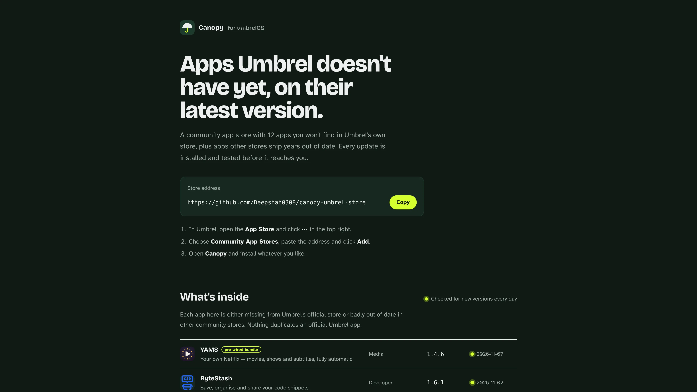
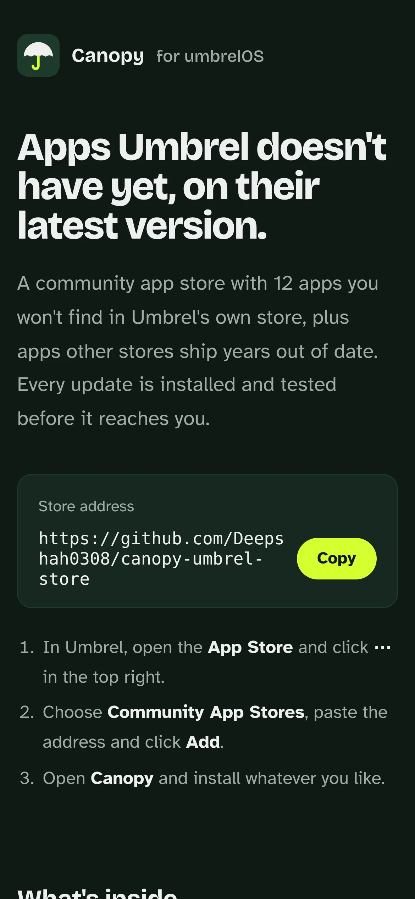
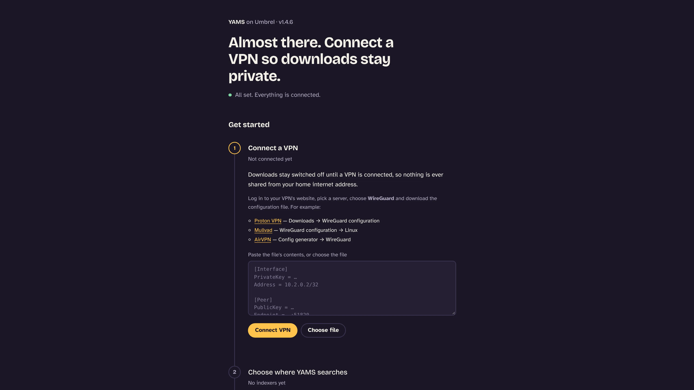

# Canopy

Apps for your Umbrel that Umbrel's own store doesn't have, kept on their newest versions and tested before every update.

**Install:** in Umbrel, open App Store → ⋯ → Community App Stores and paste `https://github.com/Deepshah0308/canopy-umbrel-store`

<!-- SHOWCASE:START — generated by chanmeng-readme-showcase; edit docs/showcase/showcase.scenario.json and re-run instead of hand-editing -->


<details>
<summary>📸 More screenshots</summary>

| Website | Phone | YAMS dashboard |
|---|---|---|
| <a href="https://deepshah0308.github.io/canopy-umbrel-store/"></a> |  |  |

</details>

<!-- docs/showcase/demo.mp4 holds a higher-quality version of the demo. -->
<!-- SHOWCASE:END -->

**See every app and version live: https://deepshah0308.github.io/canopy-umbrel-store/**

**📖 Docs: https://deepshah0308.github.io/canopy-umbrel-store/guide/**

[](https://github.com/Deepshah0308/canopy-umbrel-store/actions/workflows/checks.yml)
[](https://github.com/Deepshah0308/canopy-umbrel-store/actions/workflows/update-apps.yml)
[](LICENSE)

Canopy is a community app store for [umbrelOS](https://umbrel.com) with apps Umbrel's own store doesn't have, plus apps that other community stores ship years out of date. Every app is pinned to an exact upstream release, checked for new versions every day, and **installed and tested before an update reaches you**.

It's also the home of **YAMS**, a complete media server (Jellyfin, Sonarr, Radarr, Prowlarr, Bazarr, qBittorrent behind a VPN) that comes already wired together.

## Add the store

<!-- --8<-- [start:add-store] -->
1. In Umbrel, open the **App Store**, click **⋯** (top right) and choose **Community App Stores**.
2. Paste this address and click **Add**:

   ```
   https://github.com/Deepshah0308/canopy-umbrel-store
   ```
3. Open **Canopy** and install whatever you like. Umbrel warns that community apps aren't reviewed by Umbrel; that's expected.
<!-- --8<-- [end:add-store] -->

## What's inside

<!-- --8<-- [start:apps] -->
| App | What it is | Why it's here |
|---|---|---|
| **YAMS** | Pre-wired media server, with Seerr, Lidarr, Recyclarr, Unpackerr and Decluttarr one switch away | Nothing else on Umbrel sets the whole stack up for you |
| **Netdata** | Live health of your Umbrel and every app | The other package is on 1.47 and doesn't watch the real machine |
| **JDownloader 2** | Download manager for file hosts and video sites | The other package is a 2024 build |
| **openHAB** | Vendor-neutral home automation | The other package is on 4.2; this is 5.2 |
| **SiYuan** | Block-based notes and knowledge base | The other package is on 3.1; this is 3.8 |
| **linkding** | Minimal bookmark manager | Not on any Umbrel store |
| **Miniflux** | Fast, minimalist RSS reader | Not on any Umbrel store |
| **NZBGet** | Lightweight Usenet downloader | Not on any Umbrel store |
| **Feishin** | Music player for Jellyfin and Navidrome | Not on any Umbrel store |
| **ByteStash** | Code snippet manager | Not on any Umbrel store |
| **Mylar3** | Comic book automation | Not on any Umbrel store |
| **RustFS** | S3-compatible object storage, a MinIO alternative | The other package is an early alpha that gives every install the same secret key |

The website always shows each app's current version and when it was last updated.
<!-- --8<-- [end:apps] -->

## How Canopy stays current

<!-- --8<-- [start:updates] -->
Every morning a [GitHub Action](https://github.com/Deepshah0308/canopy-umbrel-store/blob/main/.github/workflows/update-apps.yml) runs [`tools/ship_updates.py`](https://github.com/Deepshah0308/canopy-umbrel-store/blob/main/tools/ship_updates.py):

1. **Check.** For every image it asks the registry for newer releases. Only real releases count: a tag must look like the one in use (`v`, number of parts, suffixes like `-alpine`), so betas, release candidates and nightlies are ignored. Databases stay on their major version; language runtimes on their minor version.
2. **Verify.** A new version must run on both amd64 (Umbrel Home, PCs) and arm64 (Raspberry Pi), and must have been built after the one in use. Images are pinned by digest, and rebuilt tags (security fixes) refresh the digest.
3. **Test.** [`tools/umbrel_sim.py`](https://github.com/Deepshah0308/canopy-umbrel-store/blob/main/tools/umbrel_sim.py) installs the updated app exactly the way umbrelOS does (same folders, environment and container names, `app_proxy` replaced by a check) and confirms every container stays up and the web UI answers.
4. **Ship or ask.** Patch, minor and rebuild updates that pass go straight to `main`, and Umbrel offers them within the hour. Major versions, and anything that fails, become a pull request with the test output attached.

Every pull request also runs the unit tests, the store rules ([`tests/test_store.py`](https://github.com/Deepshah0308/canopy-umbrel-store/blob/main/tests/test_store.py)), the online checks ([`tools/lint_store.py`](https://github.com/Deepshah0308/canopy-umbrel-store/blob/main/tools/lint_store.py): both CPU architectures, no port clashes with Umbrel's official store or other popular stores, no duplicates of official apps) and the install test for each changed app.
<!-- --8<-- [end:updates] -->

## Store rules

<!-- --8<-- [start:rules] -->
- Only apps that aren't in Umbrel's official store, or that other stores ship badly out of date.
- Every image pinned to a release tag **and** its digest, from the app's official publisher.
- Runs on amd64 and arm64.
- Apps with their own login skip Umbrel's login (no double sign-in). Apps without one stay behind Umbrel's login.
- Least privilege: nothing gets the Docker socket, host folders or capabilities it doesn't need. (Netdata reads container names through a read-only proxy that can't start, stop or change anything.)
- No secrets in the repository. Passwords come from Umbrel (`APP_PASSWORD`, shown on the app's page) or are generated on the device.
<!-- --8<-- [end:rules] -->

## YAMS

<!-- --8<-- [start:yams] -->
YAMS ([Yet Another Media Server](https://yams.media)) packaged so a complete beginner can go from "install" to "watching" without a terminal or a config file. Open it after installing and the dashboard walks you through four steps: connect a VPN (paste a WireGuard file), add indexers in Prowlarr, add a show or movie, and watch in Jellyfin at `http://umbrel.local:8097`.

**Moving from the old YAMS store** (`yams-umbrel-store`, app id `yams-media`)? The old and new YAMS use the same ports, so they can't run side by side. Backups are kept in your Downloads folder, which uninstalling doesn't touch:

1. In the old YAMS, open **Backups** and press **Back up now**.
2. Uninstall the old YAMS (your media and backups in Downloads stay).
3. In **Community App Stores**, remove the old YAMS store and add Canopy's address.
4. Install YAMS from Canopy, open **Backups** and restore the backup from step 1.

Settings, logins, VPN and library come across, and YAMS re-points every connection to its new containers. Jellyfin keeps port 8097, so TV and phone apps keep working.
<!-- --8<-- [end:yams] -->

### Extras

<!-- --8<-- [start:extras] -->
Optional apps that ship with YAMS, off until you switch them on in the dashboard's **Extras** section. While off, each one only runs a tiny wait loop. When you switch one on, YAMS writes its settings and connects it:

| Extra | What YAMS sets up for you |
|---|---|
| **Seerr** (port 7475) | Signs in to Jellyfin, turns on the Movies and Shows libraries, adds Sonarr and Radarr, finishes the setup wizard. Family members sign in with their Jellyfin accounts. |
| **Lidarr** | Music root folder, qBittorrent (category `music`), Prowlarr link, and a Music library in Jellyfin |
| **Recyclarr** | Syncs the TRaSH Guides quality sizes plus a WEB-1080p profile (Sonarr) and HD Bluray + WEB profile (Radarr), daily; Seerr then requests with them |
| **Unpackerr** | Watches Sonarr, Radarr (and Lidarr) for `.rar` downloads and unpacks them |
| **Decluttarr** | Removes stalled, failed and slow downloads and searches again. Never touches private-tracker torrents or torrents you added yourself |
<!-- --8<-- [end:extras] -->

### What's done automatically

<!-- --8<-- [start:automatic] -->
| Normally you'd have to… | YAMS on Umbrel does it for you |
|---|---|
| Run Jellyfin's setup wizard and create libraries | Creates the admin user and **Movies** + **Shows** libraries, with real-time folder watching |
| Copy API keys between apps | Generates keys up front and wires Sonarr, Radarr, Prowlarr and Bazarr together |
| Add qBittorrent to Sonarr and Radarr | Done, with `tv` / `movies` categories |
| Set library folders | `/data/media/tv` and `/data/media/movies`, hardlink-friendly ([TRaSH layout](https://trash-guides.info/File-and-Folder-Structure/)) |
| Set up FlareSolverr | Added to Prowlarr with the `flaresolverr` tag |
| Write gluetun environment variables | Paste a WireGuard file; the hostname is resolved to an IP and IPv6 is stripped, which gluetun requires |
| Turn on file renaming | On in both Sonarr and Radarr |
| Log in to five different web UIs | Everything except Jellyfin sits behind your Umbrel login |

The one thing left for you inside an app is picking subtitle languages in **Bazarr → Settings → Languages**.
<!-- --8<-- [end:automatic] -->

### Managing YAMS

<!-- --8<-- [start:managing] -->
Once setup is done, the YAMS dashboard becomes the control panel for the whole stack (the equivalent of the `yams` command-line tool):

| YAMS CLI | On Umbrel |
|---|---|
| `yams check-vpn` | **VPN check** compares your home address with the one downloads use, and confirms qBittorrent is inside the VPN |
| `yams logs` | **Logs** on every app, live-updating, with errors highlighted and a Copy button |
| `yams restart` | **Restart** on every app, or **Restart all** (the VPN is restarted before qBittorrent so it reconnects cleanly) |
| `yams backup` | **Backups**: back up on demand or automatically (daily or weekly, keeping the last 3, 5 or 10), and **Restore** any backup with one click |
| `yams update` | **Update apps** checks Docker Hub and updates every app to its newest version with one click, or automatically each week. It backs up your settings first |

Two widgets are available for the Umbrel home screen: a stats card (VPN, downloads, shows, movies) and a live list of active downloads. Right-click the home screen and choose **Edit widgets** to add them.

**Backups** work like `yams backup`: apps pause for a moment so their databases are saved cleanly, then every app's settings and history, your logins and API keys, and your VPN file go into one `.tar.gz` in **Downloads → yams-backups**. Caches, logs and cover art are left out (they rebuild themselves), and your media files are never included. Automatic backups run between 3 and 5 AM, Umbrel's clock.

Restoring checks the file first: it must be a YAMS for Umbrel backup that contains nothing but app settings, or it's refused before anything stops. YAMS then saves a safety backup of your current setup, swaps the restored settings in and starts the apps. If anything fails part-way, the previous settings are put back. You can restore on a fresh install too: install YAMS, upload your backup (or copy it into Downloads → yams-backups with the Files app) and choose **Restore**.

Backups contain your passwords and VPN key, so keep copies somewhere private.

**Quick fixes** repair the most common problems with one click: connect Prowlarr to Sonarr and Radarr, connect qBittorrent to them, fix library folders, rescan Jellyfin, search for missing episodes and movies, and reconnect the VPN. **Fix everything** runs the first three. Each fix checks first and only changes what's wrong. YAMS also re-checks the Prowlarr and qBittorrent connections every 10 minutes by itself.

**Search through the VPN.** If your internet provider blocks indexer sites, switch on **Search through the VPN** under **VPN check**. Prowlarr's searches and FlareSolverr then go out through the VPN too, the same idea as YAMS's [Prowlarr behind VPN](https://yams.media/advanced/prowlarr-behind-vpn/) guide but with no compose editing. They use the VPN container's built-in proxy rather than its network, so Prowlarr still reaches Sonarr and Radarr directly. If the VPN drops, searches pause instead of going around it.

**Two kinds of updates.** *App updates* (new Sonarr, Jellyfin and so on) happen from the YAMS dashboard whenever you like. The apps use moving tags such as `latest`, so YAMS can check Docker Hub, download new images and swap each container for a new one with identical settings. It backs up your settings first and rolls back any app that won't start. *YAMS updates* (new dashboard features and fixes) arrive through Umbrel's own **Update** button when a new version is published here.

**Security.** The media apps sit on a private network other Umbrel apps can't reach, and every web page is behind your Umbrel login. The dashboard's controls are only reachable through the router, never the network. Your password is hidden until you press **Show**, and **Change password** updates every app at once. See [SECURITY.md](https://github.com/Deepshah0308/canopy-umbrel-store/blob/main/SECURITY.md) for details and how to report a problem privately.

**Docker access.** The dashboard mounts the Docker socket so it can read logs, restart containers and update apps, the same approach Umbrel's Portainer and Dozzle apps use. It only ever acts on containers that belong to the YAMS app (by their Docker Compose project label), and can't restart itself.
<!-- --8<-- [end:managing] -->

### How it fits together

<!-- --8<-- [start:how] -->
```
Umbrel login ──► web (Caddy) ─┬─ /            dashboard (setup + auto-wiring)
                              ├─ /sonarr      Sonarr
                              ├─ /radarr      Radarr
                              ├─ /prowlarr    Prowlarr ── FlareSolverr
                              ├─ /bazarr      Bazarr
                              └─ /qbittorrent qBittorrent ─┐
                                                           │ shares network with
port 8097 ──► Jellyfin                          gluetun (WireGuard VPN)
```

**Downloads can't leak.** qBittorrent runs inside gluetun's network, so its only route out is the VPN, and gluetun's firewall blocks everything else. On top of that, qBittorrent won't start until the VPN tunnel (`tun0`) exists, and a watchdog stops it within about 10 seconds if the tunnel disappears. When you switch VPN files, YAMS stops qBittorrent first, reconnects, then brings it back.

**Files** live in Umbrel's Downloads folder: `Downloads/torrents` (in progress) and `Downloads/media` (your library). Because both are on one mount, Sonarr and Radarr hardlink finished downloads instead of copying them, so seeding doesn't double your disk usage.
<!-- --8<-- [end:how] -->

### Troubleshooting YAMS

<!-- --8<-- [start:troubleshooting] -->
Start with **Quick fixes → Fix everything** in the YAMS dashboard. It solves most connection problems.

- **qBittorrent says "Waiting for the VPN".** Open **Logs** on the **VPN** row. The last lines say why the tunnel isn't up (an expired key, an unreachable server). Downloading a fresh WireGuard file for another server fixes most cases.
- **An app says "Keeps restarting".** Its row shows the last log line; open **Logs** for the full story.
- **VPN says "Can't connect".** Download a file for a different server. Some providers' files expire, and a few (e.g. NordVPN) don't offer WireGuard downloads at all; Proton VPN, Mullvad and AirVPN all do.
- **Port 8097 is taken.** Denny's store has an Emby app on the same port; you can't run both. Otherwise change `8097:8096` in `docker-compose.yml` and `JELLYFIN_PORT` on the dashboard service to the same new number.
- **You changed the qBittorrent password.** Update it in Sonarr and Radarr under Settings → Download Clients.
- **Logs.** Use **Logs** on any app in the YAMS dashboard. Umbrel's own Troubleshoot view (right-click YAMS) works too. Lines starting with `[yams]` come from this package.
- **Start over.** Back up first, then uninstall YAMS (this deletes its settings, not your media or backups in Downloads) and install again. Restore the backup if you want your settings back.
- **A restore went wrong.** Every restore first saves a "Before restore" backup; restore that one to get back to where you were.
<!-- --8<-- [end:troubleshooting] -->

### Known limits

<!-- --8<-- [start:limits] -->
- VPN setup supports WireGuard files. OpenVPN-only providers aren't covered by the dashboard yet.
- VPN port forwarding isn't configured, so torrents work but may connect to fewer peers.
- Hardware transcoding needs umbrelOS 2.1 or newer, which passes your graphics card (Intel, AMD or NVIDIA) to YAMS. Then pick it in Jellyfin under Dashboard → Playback → Transcoding (VAAPI or QSV for Intel/AMD, NVENC for NVIDIA).
- Only the Downloads folder is used; external drives need Umbrel 2.0's folder access feature or a manual mount.
<!-- --8<-- [end:limits] -->

## Repository layout

```
umbrel-app-store.yml          store id "canopy"
canopy-<app>/                 one folder per app: umbrel-app.yml + docker-compose.yml
canopy-yams/hooks/yams/       YAMS's own code (dashboard, setup, VPN scripts, extras)
tools/
  umbrel_sim.py               install an app the way umbrelOS does and check it works
  update_apps.py              find and apply newer releases
  ship_updates.py             the daily bot: update, test, ship or open a pull request
  lint_store.py               online checks: architectures, ports, duplicates
  registry.py                 small container registry client
  build_site.py               fills the website's app list
docs/                         the website (GitHub Pages); docs/guide is built from guide/
guide/ + mkdocs.yml           the docs site source (MkDocs Material)
tests/                        unit tests and store rules, run on every pull request
```

## Contributing

New apps, fixes and ideas are welcome; see [CONTRIBUTING.md](CONTRIBUTING.md). Changes are listed in [CHANGELOG.md](CHANGELOG.md), and security reports go through [SECURITY.md](SECURITY.md).

Good places to start: [good first issues](https://github.com/Deepshah0308/canopy-umbrel-store/issues?q=is%3Aopen+label%3A%22good+first+issue%22), app requests in [Discussions](https://github.com/Deepshah0308/canopy-umbrel-store/discussions), or testing an app on your own Umbrel and reporting what breaks.

<a href="https://github.com/Deepshah0308/canopy-umbrel-store/graphs/contributors"></a>

## Sponsor

Canopy is free and run in spare time. If it saves you an evening of Docker wrangling, [sponsoring on GitHub](https://github.com/sponsors/Deepshah0308) keeps the apps updated and tested.

## Credits

[YAMS](https://yams.media) by rogs, every app's own authors, [gluetun](https://github.com/qdm12/gluetun), the [linuxserver.io](https://linuxserver.io) images, [TRaSH Guides](https://trash-guides.info), [dashboard-icons](https://github.com/homarr-labs/dashboard-icons) for app icons, and the [Umbrel community app store template](https://github.com/getumbrel/umbrel-community-app-store).
